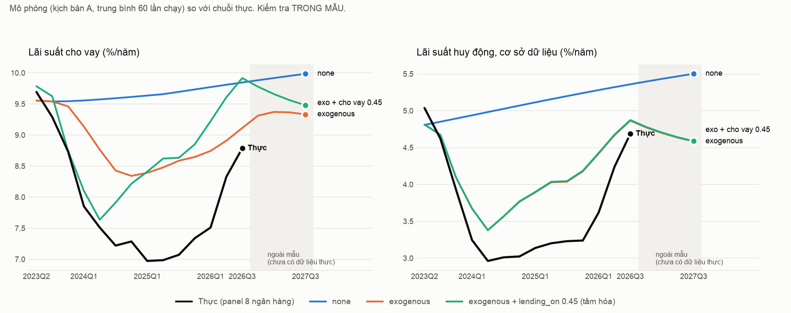

# Giai đoạn 8: biến vĩ mô ngoại sinh trong phương trình huy động (sinh tự động)

> 60 lần chạy mỗi kịch bản, seed = base_seed + run_id (cùng seed cho mọi biến thể), dữ liệu 8 ngân hàng thật, khởi tạo 2023Q1, cơ sở `term`, 18 quý, chính sách từ bước 15 (Q4/2026). **Mặc định của dự án vẫn là `macro_driver: none`.** Tham số chưa hiệu chỉnh lại (λ, δ, base_step, base_growth, ngưỡng chặn: Giai đoạn 9). Mọi so sánh với chuỗi thực là **kiểm tra TRONG MẪU** (φ, spread lấy từ chính dữ liệu 2023Q1-2026Q3 ở Giai đoạn 7b), không phải dự báo ngoài mẫu và không phải tác động chính sách thực tế.

Biến thể: `none` = Không có biến vĩ mô (none); `exogenous` = exogenous (neo ON trong huy động); `exogenous_lending045` = exogenous + lending_on 0.45; `ref_lending045_khong_tam_hoa` = (tham khảo) lending_on 0.45 không tâm hóa (ref = 0). Biến thể cuối chỉ để tham khảo vì tôi chọn tâm hóa số hạng ON cho cho vay (hệ số 0.45 ước lượng trên ON đã trừ trung bình mẫu); nó KHÔNG phải biến thể được yêu cầu.

Lãi suất huy động ở cơ sở dữ liệu = `deposit_rate × (1 − casa)` gia quyền theo tiền gửi (cột `deposit_rate` của mô hình ở cơ sở `term` là lãi suất kỳ hạn). Kịch bản A không dùng số ngẫu nhiên nên 60 lần chạy A giống hệt nhau; chuỗi A trước chính sách trùng B, C.

## Độ khớp với chuỗi thực 2023Q2-2026Q3 (14 quý; thước chính: RMSE khử mức, biên độ chữ V, quý đáy)

`RMSE_khu_muc` = độ lệch chuẩn của sai số (đã bỏ sai số trung bình); `ty_le_giam` và `ty_le_hoi_phuc` = biên độ của mô hình chia biên độ thực (giảm từ quý đầu xuống đáy; hồi phục từ đáy tới 2026Q3). Thước phụ: `RMSE_tho`, `sai_so_tb` (mô hình − thực).

| bien_the | chuoi | RMSE_khu_muc | RMSE_tho | sai_so_tb | tuong_quan | giam_mo_hinh | giam_thuc | ty_le_giam | hoi_phuc_mo_hinh | hoi_phuc_thuc | ty_le_hoi_phuc | quy_day_mo_hinh | quy_day_thuc |
|---|---|---|---|---|---|---|---|---|---|---|---|---|---|
| none | cho_vay | 0.894 | 1.968 | 1.753 | -0.164 | 0.015 | 2.720 | 0.005 | 0.306 | 1.813 | 0.169 | 2023Q3 | 2025Q1 |
| none | huy_dong | 0.731 | 1.609 | 1.433 | -0.138 | 0.000 | 2.075 | 0.000 | 0.551 | 1.725 | 0.319 | 2023Q2 | 2024Q2 |
| exogenous | cho_vay | 0.505 | 1.090 | 0.966 | 0.937 | 1.213 | 2.720 | 0.446 | 0.771 | 1.813 | 0.425 | 2024Q4 | 2025Q1 |
| exogenous | huy_dong | 0.334 | 0.594 | 0.491 | 0.904 | 1.433 | 2.075 | 0.691 | 1.487 | 1.725 | 0.862 | 2024Q2 | 2024Q2 |
| exogenous_lending045 | cho_vay | 0.617 | 1.098 | 0.908 | 0.713 | 2.150 | 2.720 | 0.790 | 2.281 | 1.813 | 1.258 | 2024Q2 | 2025Q1 |
| exogenous_lending045 | huy_dong | 0.337 | 0.599 | 0.495 | 0.901 | 1.432 | 2.075 | 0.690 | 1.494 | 1.725 | 0.866 | 2024Q2 | 2024Q2 |
| ref_lending045_khong_tam_hoa | cho_vay | 0.782 | 2.571 | 2.449 | 0.497 | 1.341 | 2.720 | 0.493 | 2.309 | 1.813 | 1.273 | 2024Q2 | 2025Q1 |
| ref_lending045_khong_tam_hoa | huy_dong | 0.330 | 0.578 | 0.475 | 0.912 | 1.439 | 2.075 | 0.694 | 1.451 | 1.725 | 0.841 | 2024Q2 | 2024Q2 |

## Tác động chính sách (B−A, C−A; chênh theo cặp cùng seed, điểm %/năm)

| bien_the | thoi_diem | bien | so_sanh | tb | sd | min | max |
|---|---|---|---|---|---|---|---|
| none | cuoi_ky | loan_rate | B-A | -0.5058 | 0.0299 | -0.5360 | -0.3758 |
| none | cuoi_ky | loan_rate | C-A | -0.5548 | 0.0243 | -0.5793 | -0.4939 |
| none | tb_sau_chinh_sach | loan_rate | B-A | -0.4110 | 0.0199 | -0.4343 | -0.3529 |
| none | tb_sau_chinh_sach | loan_rate | C-A | -0.4329 | 0.0186 | -0.4538 | -0.3753 |
| none | cuoi_ky | deposit_rate_data_basis | B-A | 0.0013 | 0.0001 | 0.0009 | 0.0013 |
| none | cuoi_ky | deposit_rate_data_basis | C-A | -0.0755 | 0.0000 | -0.0756 | -0.0755 |
| none | tb_sau_chinh_sach | deposit_rate_data_basis | B-A | 0.0005 | 0.0000 | 0.0004 | 0.0005 |
| none | tb_sau_chinh_sach | deposit_rate_data_basis | C-A | -0.0482 | 0.0000 | -0.0483 | -0.0482 |
| exogenous | cuoi_ky | loan_rate | B-A | -0.5186 | 0.0235 | -0.5404 | -0.4484 |
| exogenous | cuoi_ky | loan_rate | C-A | -0.5696 | 0.0237 | -0.5909 | -0.4989 |
| exogenous | tb_sau_chinh_sach | loan_rate | B-A | -0.4178 | 0.0181 | -0.4368 | -0.3633 |
| exogenous | tb_sau_chinh_sach | loan_rate | C-A | -0.4420 | 0.0182 | -0.4607 | -0.3872 |
| exogenous | cuoi_ky | deposit_rate_data_basis | B-A | 0.0011 | 0.0001 | 0.0007 | 0.0011 |
| exogenous | cuoi_ky | deposit_rate_data_basis | C-A | -0.0854 | 0.0000 | -0.0855 | -0.0854 |
| exogenous | tb_sau_chinh_sach | deposit_rate_data_basis | B-A | 0.0004 | 0.0000 | 0.0003 | 0.0005 |
| exogenous | tb_sau_chinh_sach | deposit_rate_data_basis | C-A | -0.0585 | 0.0000 | -0.0585 | -0.0585 |
| exogenous_lending045 | cuoi_ky | loan_rate | B-A | -0.5233 | 0.0212 | -0.5404 | -0.4628 |
| exogenous_lending045 | cuoi_ky | loan_rate | C-A | -0.5752 | 0.0205 | -0.5912 | -0.5136 |
| exogenous_lending045 | tb_sau_chinh_sach | loan_rate | B-A | -0.4231 | 0.0166 | -0.4368 | -0.3633 |
| exogenous_lending045 | tb_sau_chinh_sach | loan_rate | C-A | -0.4476 | 0.0168 | -0.4609 | -0.3873 |
| exogenous_lending045 | cuoi_ky | deposit_rate_data_basis | B-A | 0.0011 | 0.0001 | 0.0007 | 0.0011 |
| exogenous_lending045 | cuoi_ky | deposit_rate_data_basis | C-A | -0.0855 | 0.0000 | -0.0856 | -0.0855 |
| exogenous_lending045 | tb_sau_chinh_sach | deposit_rate_data_basis | B-A | 0.0004 | 0.0000 | 0.0003 | 0.0005 |
| exogenous_lending045 | tb_sau_chinh_sach | deposit_rate_data_basis | C-A | -0.0587 | 0.0000 | -0.0588 | -0.0587 |
| ref_lending045_khong_tam_hoa | cuoi_ky | loan_rate | B-A | -0.5344 | 0.0107 | -0.5403 | -0.4785 |
| ref_lending045_khong_tam_hoa | cuoi_ky | loan_rate | C-A | -0.5656 | 0.0107 | -0.5714 | -0.5097 |
| ref_lending045_khong_tam_hoa | tb_sau_chinh_sach | loan_rate | B-A | -0.4317 | 0.0089 | -0.4368 | -0.4009 |
| ref_lending045_khong_tam_hoa | tb_sau_chinh_sach | loan_rate | C-A | -0.4466 | 0.0089 | -0.4517 | -0.4158 |
| ref_lending045_khong_tam_hoa | cuoi_ky | deposit_rate_data_basis | B-A | 0.0012 | 0.0000 | 0.0011 | 0.0013 |
| ref_lending045_khong_tam_hoa | cuoi_ky | deposit_rate_data_basis | C-A | -0.0493 | 0.0000 | -0.0493 | -0.0493 |
| ref_lending045_khong_tam_hoa | tb_sau_chinh_sach | deposit_rate_data_basis | B-A | 0.0005 | 0.0000 | 0.0004 | 0.0005 |
| ref_lending045_khong_tam_hoa | tb_sau_chinh_sach | deposit_rate_data_basis | C-A | -0.0348 | 0.0000 | -0.0348 | -0.0348 |

## Tuân thủ chỉ đạo (các quý có chính sách)

| variant | scenario | ty_le_tuan_thu_tb | ty_le_tuan_thu_sd | xac_suat_tb |
|---|---|---|---|---|
| exogenous | B | 0.9542 | 0.0333 | 0.9433 |
| exogenous | C | 0.9552 | 0.0332 | 0.9452 |
| exogenous_lending045 | B | 0.9661 | 0.0306 | 0.9567 |
| exogenous_lending045 | C | 0.9672 | 0.0312 | 0.9582 |
| none | B | 0.9474 | 0.0352 | 0.9393 |
| none | C | 0.9521 | 0.0323 | 0.9409 |
| ref_lending045_khong_tam_hoa | B | 0.9854 | 0.0203 | 0.9800 |
| ref_lending045_khong_tam_hoa | C | 0.9854 | 0.0203 | 0.9800 |

## Kiểm tra hợp lý kinh tế (mục 6 CLAUDE.md)

| bien_the | chenh_toi_da_A_B_C_truoc_chinh_sach | vi_pham_B_cao_hon_A | vi_pham_C_cao_hon_A | loan_rate_min | loan_rate_max | deposit_rate_min | deposit_rate_max | quan_sat_chan_tran_huy_dong_14 | ldr_toi_da |
|---|---|---|---|---|---|---|---|---|---|
| none | 0.000000 | 0 | 0 | 8.131275 | 12.405120 | 4.939109 | 7.435213 | 0 | 1.600000 |
| exogenous | 0.000000 | 0 | 0 | 7.654639 | 12.405120 | 3.818670 | 7.011237 | 0 | 1.599125 |
| exogenous_lending045 | 0.000000 | 0 | 0 | 6.752630 | 12.636434 | 3.820068 | 7.011237 | 0 | 1.590980 |
| ref_lending045_khong_tam_hoa | 0.000000 | 0 | 0 | 8.372123 | 13.445592 | 3.811188 | 7.011237 | 0 | 1.318533 |

## Drift và mức cân bằng ngụ ý khi giữ nguyên base_step và deposit_competition

Với `macro_driver: exogenous` mức cân bằng của lãi suất huy động (cơ sở `term`) là `ON + spread + drift/φ`, trong đó drift là trung bình của `desired_increase = base_step + deposit_competition·clip(LDR − 0.82, ±0.5)` (trước số hạng neo ON). Giữ drift thì mức cân bằng cao hơn `ON + spread` một khoảng `drift/φ`.

| drift_tb_desired_increase | phi | drift_chia_phi | spread | ON_tb_2023Q1_2026Q2 | ON_cuoi_2026Q3 | can_bang_ngu_y_ON_tb | can_bang_ngu_y_ON_2026Q3 | r_D_term_tb_khoi_tao |
|---|---|---|---|---|---|---|---|---|
| 0.0329 | 0.1770 | 0.1859 | 1.2723 | 3.7461 | 3.9460 | 5.2043 | 5.4042 | 6.3869 |

## Chuỗi theo quý, kịch bản A: `none`

| month | quarter | actual_loan_rate | loan_rate | actual_deposit_rate | deposit_rate_data_basis | deposit_rate_term_basis |
|---|---|---|---|---|---|---|
| 1 | 2023Q2 | 9.692 | 9.554 | 5.036 | 4.808 | 6.060 |
| 2 | 2023Q3 | 9.289 | 9.540 | 4.622 | 4.851 | 6.109 |
| 3 | 2023Q4 | 8.735 | 9.543 | 3.922 | 4.894 | 6.159 |
| 4 | 2024Q1 | 7.850 | 9.556 | 3.246 | 4.938 | 6.210 |
| 5 | 2024Q2 | 7.511 | 9.573 | 2.962 | 4.982 | 6.261 |
| 6 | 2024Q3 | 7.220 | 9.592 | 3.011 | 5.026 | 6.312 |
| 7 | 2024Q4 | 7.286 | 9.613 | 3.023 | 5.070 | 6.364 |
| 8 | 2025Q1 | 6.972 | 9.635 | 3.138 | 5.114 | 6.415 |
| 9 | 2025Q2 | 6.985 | 9.657 | 3.202 | 5.157 | 6.465 |
| 10 | 2025Q3 | 7.071 | 9.695 | 3.230 | 5.199 | 6.515 |
| 11 | 2025Q4 | 7.338 | 9.733 | 3.239 | 5.240 | 6.563 |
| 12 | 2026Q1 | 7.510 | 9.771 | 3.620 | 5.281 | 6.610 |
| 13 | 2026Q2 | 8.328 | 9.809 | 4.239 | 5.320 | 6.657 |
| 14 | 2026Q3 | 8.785 | 9.846 | 4.687 | 5.359 | 6.702 |
| 15 | 2026Q4 |  | 9.882 |  | 5.396 | 6.746 |
| 16 | 2027Q1 |  | 9.917 |  | 5.432 | 6.789 |
| 17 | 2027Q2 |  | 9.952 |  | 5.468 | 6.831 |
| 18 | 2027Q3 |  | 9.986 |  | 5.502 | 6.871 |

## Chuỗi theo quý, kịch bản A: `exogenous`

| month | quarter | actual_loan_rate | loan_rate | actual_deposit_rate | deposit_rate_data_basis | deposit_rate_term_basis |
|---|---|---|---|---|---|---|
| 1 | 2023Q2 | 9.692 | 9.554 | 5.036 | 4.812 | 6.070 |
| 2 | 2023Q3 | 9.289 | 9.541 | 4.622 | 4.674 | 5.896 |
| 3 | 2023Q4 | 8.735 | 9.461 | 3.922 | 4.089 | 5.157 |
| 4 | 2024Q1 | 7.850 | 9.136 | 3.246 | 3.674 | 4.633 |
| 5 | 2024Q2 | 7.511 | 8.764 | 2.962 | 3.379 | 4.260 |
| 6 | 2024Q3 | 7.220 | 8.428 | 3.011 | 3.566 | 4.498 |
| 7 | 2024Q4 | 7.286 | 8.342 | 3.023 | 3.766 | 4.751 |
| 8 | 2025Q1 | 6.972 | 8.391 | 3.138 | 3.893 | 4.912 |
| 9 | 2025Q2 | 6.985 | 8.477 | 3.202 | 4.029 | 5.084 |
| 10 | 2025Q3 | 7.071 | 8.586 | 3.230 | 4.037 | 5.095 |
| 11 | 2025Q4 | 7.338 | 8.646 | 3.239 | 4.178 | 5.273 |
| 12 | 2026Q1 | 7.510 | 8.744 | 3.620 | 4.419 | 5.578 |
| 13 | 2026Q2 | 8.328 | 8.909 | 4.239 | 4.668 | 5.892 |
| 14 | 2026Q3 | 8.785 | 9.113 | 4.687 | 4.866 | 6.143 |
| 15 | 2026Q4 |  | 9.312 |  | 4.773 | 6.027 |
| 16 | 2027Q1 |  | 9.371 |  | 4.697 | 5.931 |
| 17 | 2027Q2 |  | 9.365 |  | 4.635 | 5.853 |
| 18 | 2027Q3 |  | 9.331 |  | 4.584 | 5.789 |

## Chuỗi theo quý, kịch bản A: `exogenous_lending045`

| month | quarter | actual_loan_rate | loan_rate | actual_deposit_rate | deposit_rate_data_basis | deposit_rate_term_basis |
|---|---|---|---|---|---|---|
| 1 | 2023Q2 | 9.692 | 9.785 | 5.036 | 4.812 | 6.070 |
| 2 | 2023Q3 | 9.289 | 9.624 | 4.622 | 4.674 | 5.895 |
| 3 | 2023Q4 | 8.735 | 8.744 | 3.922 | 4.089 | 5.157 |
| 4 | 2024Q1 | 7.850 | 8.101 | 3.246 | 3.674 | 4.633 |
| 5 | 2024Q2 | 7.511 | 7.635 | 2.962 | 3.380 | 4.262 |
| 6 | 2024Q3 | 7.220 | 7.912 | 3.011 | 3.569 | 4.501 |
| 7 | 2024Q4 | 7.286 | 8.216 | 3.023 | 3.771 | 4.757 |
| 8 | 2025Q1 | 6.972 | 8.411 | 3.138 | 3.899 | 4.919 |
| 9 | 2025Q2 | 6.985 | 8.620 | 3.202 | 4.036 | 5.093 |
| 10 | 2025Q3 | 7.071 | 8.634 | 3.230 | 4.045 | 5.105 |
| 11 | 2025Q4 | 7.338 | 8.850 | 3.239 | 4.186 | 5.283 |
| 12 | 2026Q1 | 7.510 | 9.222 | 3.620 | 4.427 | 5.588 |
| 13 | 2026Q2 | 8.328 | 9.608 | 4.239 | 4.676 | 5.902 |
| 14 | 2026Q3 | 8.785 | 9.917 | 4.687 | 4.874 | 6.152 |
| 15 | 2026Q4 |  | 9.777 |  | 4.780 | 6.035 |
| 16 | 2027Q1 |  | 9.659 |  | 4.703 | 5.938 |
| 17 | 2027Q2 |  | 9.561 |  | 4.640 | 5.859 |
| 18 | 2027Q3 |  | 9.478 |  | 4.588 | 5.793 |

## Diễn giải (viết tay sau khi xem kết quả; các con số lấy từ các bảng ở trên)

**Kiểm tra TRONG MẪU, không phải kỹ năng dự báo.** φ = 0.177 và spread = 1.2723 được ước lượng ở Giai đoạn 7b trên chính dữ liệu 2023Q1-2026Q3 và ON là chuỗi thực; theo 7b, ON giải thích khoảng 62% phương sai within của Δr^D qua thành phần chung theo quý. Nên việc mô phỏng bám sát chuỗi thực hơn là kết quả được kỳ vọng, không phải bằng chứng ngoài mẫu.

**1. Neo ON trong phương trình huy động (`exogenous`) cải thiện rõ hình dạng so với `none`.**
- RMSE khử mức: lãi suất cho vay 0.894 → 0.505, lãi suất huy động (cơ sở dữ liệu) 0.731 → 0.334. Tương quan với chuỗi thực: −0.16 → 0.94 (cho vay) và −0.14 → 0.90 (huy động).
- `none` hầu như không có chữ V (biên độ giảm bằng 0.5% biên độ thực với cho vay, 0% với huy động). `exogenous` tái tạo biên độ giảm bằng 45% (cho vay) và 69% (huy động) biên độ thực, hồi phục 43% và 86%.
- Quý đáy: huy động 2024Q2, trùng thực; cho vay 2024Q4, lệch sớm 1 quý so với thực (2025Q1).
- **Sai số mức vẫn còn:** sai số trung bình (mô hình − thực) là +0.97 điểm % (cho vay) và +0.49 (huy động); RMSE thô 1.09 và 0.59. Biên độ chữ V của lãi suất cho vay vẫn chỉ bằng khoảng 0.4-0.45 lần thực.

**2. Số hạng ON trực tiếp trong mục tiêu cho vay (`macro_lending_on_coef = 0.45`, đã tâm hóa) KHÔNG cải thiện thước chính.**
- RMSE khử mức của cho vay tăng từ 0.505 (chỉ `exogenous`) lên 0.617, tương quan giảm từ 0.94 xuống 0.71. Biên độ giảm bằng 79% thực nhưng **hồi phục bằng 126%** (vượt quá), và đáy lệch sớm tới 3 quý (2024Q2 so với 2025Q1). RMSE thô gần như không đổi (1.09 → 1.10).
- Lãi suất huy động hầu như không đổi so với `exogenous` (RMSE khử mức 0.337 so với 0.334).
- Không tâm hóa (ref = 0, chỉ để tham khảo) thêm khoảng 0.45 × 3.7 ≈ 1.7 điểm % vào mức: sai số trung bình +2.45, RMSE thô 2.57. Kết quả rất nhạy với lựa chọn tâm hóa (và với λ = `pass_through` chưa hiệu chỉnh); hệ số 0.45 ước lượng ở Giai đoạn 7 là cho ON đã trừ trung bình mẫu. Đây là một lựa chọn, không phải kiểm định.

**3. Chênh lệch B−A, C−A ổn định giữa các biến thể của mô hình** (cùng ON thực, cùng dữ liệu, trong mẫu; không phải bằng chứng ngoài mô hình). B−A cuối kỳ là −0.506 (`none`), −0.519 (`exogenous`), −0.523 (+ cho vay 0.45); trung bình sau chính sách −0.411, −0.418, −0.423. C−A cuối kỳ −0.555, −0.570, −0.575. Mục 6 CLAUDE.md đạt ở mọi biến thể (B, C không cao hơn A; A = B = C trước chính sách; lãi suất trong miền; LDR tối đa 1.6). Tỷ lệ tuân thủ tăng nhẹ: 0.947 (`none`), 0.954 (`exogenous`), 0.966 (+ cho vay 0.45); nguyên nhân là `nim_proxy` thay đổi theo mức lãi suất (nhiễu lẫn nhỏ nhưng có thật). Cắt giảm huy động ở kịch bản C: −0.059 (sau chính sách, `exogenous`) so với −0.048 (`none`); khác biệt do số hạng neo ON không bị hạn chế bởi `deposit_cap_factor`.

**4. Mức cân bằng ngụ ý và vùng ngoài mẫu.** Giữ `base_step`, `deposit_competition` và ngưỡng 0.82, drift trung bình của `desired_increase` là 0.033 điểm %/quý, nên mức cân bằng của lãi suất huy động (cơ sở `term`) là `ON + 1.2723 + 0.186`: khoảng 5.20 khi ON bằng trung bình mẫu (3.746) và 5.40 khi ON = 3.946. Lãi suất huy động bình quân khởi tạo (6.39) cao hơn mức này nên giảm dần về phía neo; ở vùng ngoài mẫu (ON giữ 3.946, không có dữ liệu thực) lãi suất huy động (cơ sở dữ liệu) giảm từ 4.87 (2026Q3) xuống 4.58 (2027Q3) và lãi suất cho vay đi ngang khoảng 9.3-9.4. Phần này không đánh giá được bằng dữ liệu.

**Hạn chế.** (i) Trong mẫu như trên. (ii) `macro_dep_spread` lấy từ mẫu N = 112 của 7b (1.272); mẫu N = 104 và 96 cho 1.08 và 1.14, độ nhạy của kết quả theo giá trị này chưa được đo. (iii) Tâm hóa `macro_lending_on_ref` là lựa chọn của người thực hiện để khớp cách ước lượng hệ số 0.45; yêu cầu gốc không nêu. (iv) Sai số mức (+0.97 điểm % ở cho vay) và biên độ chữ V còn thiếu của lãi suất cho vay cần hiệu chỉnh λ, biên mục tiêu, base_step, base_growth và ngưỡng chặn ở Giai đoạn 9; không chỉnh ở đây. (v) Biến vĩ mô ngoại sinh chỉ có một chuỗi ON chung cho mọi ngân hàng. (vi) Hệ số 0.45 là θ/λ của biến thể (d1) với λ = 0.3145 và ước lượng trên khoảng 14 điểm theo quý; (d1) bác bỏ ràng buộc b+γ=1 nên không còn là PT1 của mô hình; mô hình dùng `pass_through = 0.48` nên tác động ON mỗi quý là 0.48 × 0.45 = 0.216 chứ không phải 0.142. Đồng bộ λ và hệ số này là việc của Giai đoạn 9.

File: quarterly_stage8.csv, fit_vs_actual_stage8.csv, effects_stage8.csv, compliance_stage8.csv, checks_stage8.csv, drift_equilibrium_stage8.csv, fig_mo_phong_vs_thuc.png, C_lai_suat_thuc_te_tu_panel.csv.
